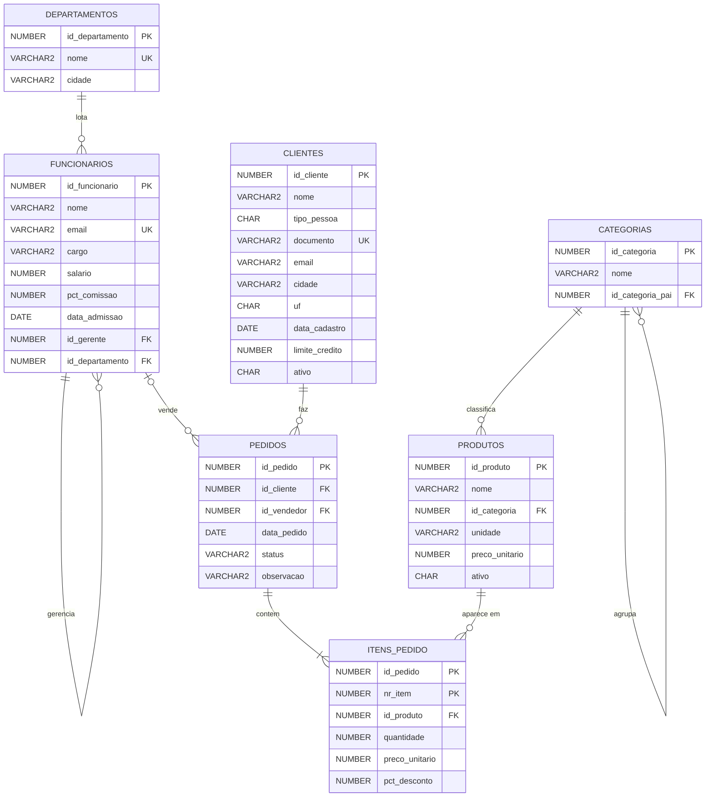

# Modelo de dados de exemplo

Distribuidora fictícia que vende itens de informática, papelaria e móveis de escritório. É pequena o bastante para conferir resultados de cabeça e tem os casos de borda que os exemplos do repositório precisam.

## Diagrama

## Tabelas

| Tabela | Linhas | Chave | Observação |
|---|---|---|---|
| departamentos | 5 | id_departamento | Marketing (50) não tem funcionários |
| funcionarios | 14 | id_funcionario | Auto-relacionamento por id_gerente; quatro níveis de hierarquia |
| clientes | 12 | id_cliente | Pessoa física (F) e jurídica (J); dois clientes sem pedido |
| categorias | 7 | id_categoria | Árvore de três níveis por id_categoria_pai |
| produtos | 15 | id_produto | Preço de tabela atual; o produto 15 nunca foi vendido |
| pedidos | 24 | id_pedido | Jan/2025 a out/2026; três pedidos sem vendedor (site) |
| itens_pedido | 54 | id_pedido + nr_item | Preço praticado na venda, que pode diferir do preço de tabela |

## Regras do modelo

- O valor líquido de um item é `quantidade * preco_unitario * (1 - pct_desconto / 100)`.
- `pct_comissao` e `pct_desconto` guardam o percentual "cheio": 5 significa 5%.
- `id_gerente` nulo só na diretoria geral; `id_vendedor` nulo indica venda pelo site.
- Pedido com status `CANCELADO` continua na base com seus itens; relatórios de venda precisam excluí-lo de forma explícita.
- `data_pedido` guarda hora. Filtro por dia com `BETWEEN DATE '2025-01-01' AND DATE '2025-01-31'` perde os pedidos feitos no dia 31 em qualquer horário após 00:00; o padrão correto é `data_pedido >= DATE '2025-01-01' AND data_pedido < DATE '2025-02-01'`.

## Casos de borda e onde são usados

| Caso | Dado | Usado em |
|---|---|---|
| Linha sem correspondente no join | Departamento 50, funcionário 113, clientes 11 e 12, produto 15 | Outer join, anti-join, NOT EXISTS |
| NULL em coluna numérica | pct_comissao, limite_credito | NVL, COALESCE, agregações, NOT IN |
| NULL em FK | id_vendedor, id_departamento | Joins, contagem com COUNT(coluna) versus COUNT(*) |
| Hierarquia | funcionarios.id_gerente, categorias.id_categoria_pai | CONNECT BY, WITH recursivo |
| Data com hora | pedidos.data_pedido | BETWEEN, TRUNC, faixas de data |
| Empate em ranking | Vendedores 104 e 105 com o mesmo pct_comissao | RANK × DENSE_RANK × ROW_NUMBER |
